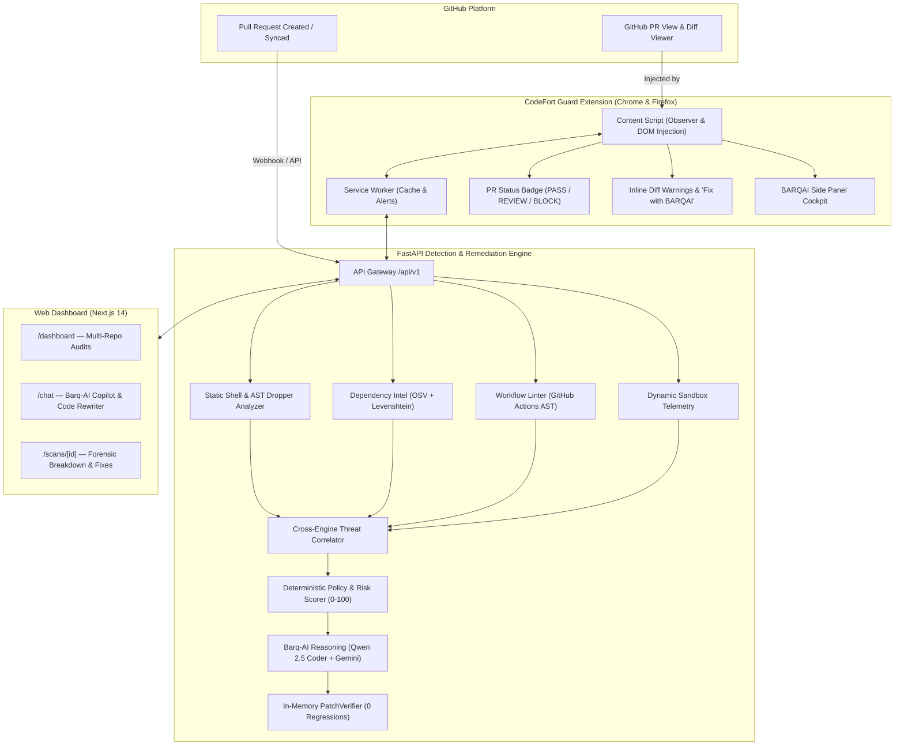

# CODEFORT // ZERO-TRUST PR & SUPPLY CHAIN DEFENSE

<p align="center">
  <a href="https://addons.mozilla.org/en-US/firefox/addon/codefort-guard/"></a>
  <a href="https://codefort-web.vercel.app"></a>
  <a href="https://github.com/codefort-sec/barqai"></a>
  <a href="https://codefort-lilac.vercel.app/docs"></a>
  <a href="https://github.com/codefort-sec/codefort/releases/tag/v0.1.3"></a>
</p>

<p align="center">
  
  
  
  
  
</p>

> **CodeFort** is an AI-native security platform that intercepts malicious GitHub pull requests, detects software supply chain poisoning, and stops CI/CD workflow injection attacks before code merges into production.
>
> Powered by **Barq-AI**—a frontier multi-provider reasoning engine combining **Qwen 2.5 Coder MoE** and **Google Gemini** with real-time **Google OSV** telemetry grounding, deterministic backend risk scoring, and autonomous 1-click patch verification.

---

## ⚡ Live Deployments & Assets

| Component | Target URL | Description |
| :--- | :--- | :--- |
| **Firefox Add-on** | [**`addons.mozilla.org`**](https://addons.mozilla.org/en-US/firefox/addon/codefort-guard/) | **Official Reviewed & Approved Store Listing (1-Click Install)** |
| **Web Dashboard** | [`codefort-web.vercel.app`](https://codefort-web.vercel.app) | Cyber Brutalist UI for PR forensics, policy management, & multi-repo audits |
| **Barq-AI Copilot Studio** | [`codefort-web.vercel.app/chat`](https://codefort-web.vercel.app/chat) | Interactive AI security assistant & unified git diff code rewriter |
| **Extension Setup Guide** | [`codefort-web.vercel.app/extension`](https://codefort-web.vercel.app/extension) | Step-by-step browser extension installer & pairing assistant |
| **Barq-AI Engine Repo** | [`codefort-sec/barqai`](https://github.com/codefort-sec/barqai) | Dedicated AI reasoning engine, LoRA training pipeline, & benchmark datasets |
| **Backend API Core** | [`codefort-lilac.vercel.app/docs`](https://codefort-lilac.vercel.app/docs) | FastAPI OpenAPI 3.0 documentation, detection engines, & remediation endpoints |
| **Chrome Extension** | [`v0.1.3 (.zip)`](https://github.com/codefort-sec/codefort/releases/download/v0.1.3/codefort-guard-chrome-v0.1.3.zip) | Manifest V3 extension with PR badges, inline diff warnings, & side panel |
| **Firefox Binaries** | [`v0.1.3 (.xpi)`](https://github.com/codefort-sec/codefort/releases/download/v0.1.3/codefort-guard-firefox-v0.1.3.xpi) / [`.zip`](https://github.com/codefort-sec/codefort/releases/download/v0.1.3/codefort-guard-firefox-v0.1.3.zip) | Standalone Mozilla WebExtension package (`codefort-guard@codefort.sec`) |
| **Malicious Test Repo** | [`vulnerable-test-repo`](https://github.com/codefort-sec/vulnerable-test-repo) | Live attack playground with adversarial PRs (#1, #2, #3) |
| **Clean Baseline Repo** | [`clean-test-repo`](https://github.com/codefort-sec/clean-test-repo) | Clean baseline repository verifying 0 risk score PASS PRs |

---

## 💡 Why CodeFort?

Humans miss subtle typosquats, remote lifecycle droppers, and workflow privilege escalations during code review. Traditional linters emit noisy false positives and lack the context to understand multi-stage exploits.

**Barq-AI** solves this by coupling frontier LLM reasoning with deterministic static analysis and vulnerability databases:
- **Grounded Evidence Citations (`[EVIDENCE: ...]`)**: Never hallucinates CVE numbers or false threats. Every claim is anchored to concrete AST and OSV telemetry.
- **Autonomous 1-Click Remediation**: Synthesizes verified unified git diffs (`clean_patch`) tested in-memory to confirm **0 regressions**.
- **Developer-Native Workflow**: Injected directly into GitHub PRs via our approved browser extension, GitHub Checks API, and web dashboard.

---

## 🏗️ System Architecture



---

## 🔍 Core Defense Capabilities

### 1. Static AST & Shell Dropper Analyzer
- Monitors lifecycle hooks (`preinstall`, `postinstall`, `prepare`) while ignoring benign build tasks (`build`, `test`, `start`).
- Intercepts remote execution pipes (`curl | bash`, `wget | sh`), base64 obfuscation (`eval(Buffer.from)`), and reverse shells.
- **Zero False-Positive Guarantee**: 0.0% false alarm rate on benign utility libraries.

### 2. Dependency Intelligence & Typosquat Detector
- Evaluates package manifests against the live **Google OSV (Open Source Vulnerability)** database for known CVEs/GHSAs across npm, PyPI, and Go.
- Heuristic Levenshtein distance matching with length threshold ($\ge 5$ chars) and curated whitelists (`jest`, `vite`, `eslint`, `zod`).

### 3. CI/CD Workflow Linter
- Flags privilege escalation in GitHub Actions (e.g. `pull_request_target` checking out untrusted fork branches).
- Detects excessive `write-all` permission scopes and untrusted context interpolation (`${{ github.event.pull_request.title }}`).

### 4. Barq-AI Unified Reasoning & In-Memory Patch Verification
- **Dual-Provider Architecture**: Google Gemini (`gemini-3.8-flash`) cascading to Qwen 2.5 Coder 32B Instruct with a 0ms deterministic fail-safe.
- **In-Memory Verification**: Every synthesized patch is syntax-checked and re-scanned in-memory to prove vulnerability eradication with **zero regressions**.

---

## 📊 Benchmark & Evaluation Results

Tested via `python -m app.ai.eval_suite --compare` against standard supply-chain attack benchmarks:

| Evaluation Metric | Qwen 2.5 Coder 32B | Google Gemini 1.5 Flash | Deterministic Fail-Safe |
| :--- | :---: | :---: | :---: |
| **Verdict Accuracy** | **100.0%** (4/4) | **100.0%** (4/4) | **100.0%** (4/4) |
| **Evidence Grounding Rate** | **100.0%** | **100.0%** | **100.0%** |
| **Remediation Viability** | **100.0%** | **100.0%** | **100.0%** |
| **Independent Patch Verify** | **100.0% (0 Regressions)** | **100.0% (0 Regressions)** | **100.0% (0 Regressions)** |
| **False Positive Resilience** | **100.0%** | **100.0%** | **100.0%** |
| **Average Latency** | **0.17s** | **0.16s** | **0.15s** |
| **OSV 20-Case Benchmark** | **20/20 (100%)** | **20/20 (100%)** | **20/20 (100%)** |

---

## 🧪 Verified Attack & Defense Matrix

| Scenario | Live PR Demo | Attack Vector | Detection Rule | Verdict | Risk Score | Remediation |
| :--- | :--- | :--- | :--- | :---: | :---: | :---: |
| **`01_malicious_preinstall`** | [`vulnerable-test-repo#1`](https://github.com/codefort-sec/vulnerable-test-repo/pull/1) | `curl \| bash` C2 dropper in `package.json` | `npm.lifecycle.preinstall` | **`BLOCKED`** | 100 / 100 | **Verified Fix** |
| **`02_typosquat_dependency`** | [`vulnerable-test-repo#2`](https://github.com/codefort-sec/vulnerable-test-repo/pull/2) | Typosquatted package `reqeusts` | `dep.typosquat` | **`REVIEW`** | 65 / 100 | **Verified Fix** |
| **`03_unsafe_workflow_injection`** | [`vulnerable-test-repo#3`](https://github.com/codefort-sec/vulnerable-test-repo/pull/3) | `pull_request_target` + `write-all` | `workflow.target.checkout` | **`BLOCKED`** | 100 / 100 | **Verified Fix** |
| **`04_clean_feature_pr`** | [`clean-test-repo#1`](https://github.com/codefort-sec/clean-test-repo/pull/1) | Benign AST math parser | *N/A (clean baseline)* | **`PASS`** | 0 / 100 | **Clean Baseline** |

---

## 📦 Extension Quick Install

Interactive installer & pairing guide: **[`codefort-web.vercel.app/extension`](https://codefort-web.vercel.app/extension)**

### Mozilla Firefox (Recommended)
1. Open [**CodeFort Guard on Firefox Add-ons (AMO)**](https://addons.mozilla.org/en-US/firefox/addon/codefort-guard/).
2. Click **+ Add to Firefox**. The extension activates immediately with automatic updates!

### Google Chrome / Chromium (Brave, Edge, Arc)
1. Download [`codefort-guard-chrome-v0.1.3.zip`](https://github.com/codefort-sec/codefort/releases/download/v0.1.3/codefort-guard-chrome-v0.1.3.zip) and extract it.
2. Go to `chrome://extensions/` and toggle **Developer mode** (top-right).
3. Click **Load unpacked** and select the extracted folder.

### Pair with CodeFort
1. Generate a single-use token on [`codefort-web.vercel.app/settings`](https://codefort-web.vercel.app/settings).
2. Click the extension toolbar icon, paste the token, and click **Pair Extension** *(status turns green `ONLINE`)*.

---

## 🚀 Local Development

### Prerequisites
- Node.js $\ge 18$
- Python $\ge 3.11$ (`uv` recommended)

```bash
# 1. Clone repository
git clone https://github.com/codefort-sec/codefort.git
cd codefort

# 2. Run Backend API (FastAPI)
cd services/api
uv sync
uv run uvicorn app.main:app --reload --port 8000

# 3. Run Web Dashboard (Next.js 14)
cd ../../apps/web
npm install
npm run dev

# 4. Build & Package Browser Extension
cd ../extension
npm install
npm run package
# Packages Chrome ZIP, Firefox XPI, and syncs to web downloads

# 5. Run Backend Tests & Benchmark
cd ../../services/api
uv run pytest tests/
python -m app.ai.eval_suite --compare
```

---

## 📂 Monorepo Structure

```
codefort/
├── apps/
│   ├── web/                     # Next.js 14 Cyber Brutalist Dashboard & Barq-AI Copilot
│   │   └── app/                 # /dashboard, /chat, /extension, /settings, /scans/[id]
│   └── extension/               # CodeFort Guard MV3 Extension (Vite + React, IIFE content script)
│       ├── public/              # Chrome & Firefox manifest definitions (Gecko ID configured)
│       └── src/                 # SidePanel.tsx, github-observer.ts, pr-header-injector.tsx
├── services/
│   └── api/                     # FastAPI Core, Multi-Engine Scanners & Barq-AI
│       ├── app/ai/              # eval_suite.py (benchmarks), knowledge_base.py, dataset.jsonl
│       ├── app/api/v1/          # repositories, scans, extension, remediation, webhooks
│       ├── app/services/engines/# barqai.py, remediation_engine.py, patch_verifier.py
│       └── tests/               # 82 automated pytest suites (100% pass rate)
└── scripts/
    └── demo_scan.py             # CLI terminal PR security scanner demonstration
```

---

## 👥 Maintainers & License

- **Lead Platform Maintainer**: [Mohammed Nishal (@nichroot)](https://github.com/nichroot)
- **Lead AI Maintainer**: [Muhammad Farsheen (@muhammadfarshi)](https://github.com/muhammadfarshi)
- **Organization**: [CodeFort Security](https://github.com/codefort-sec)
- **License**: Apache 2.0
